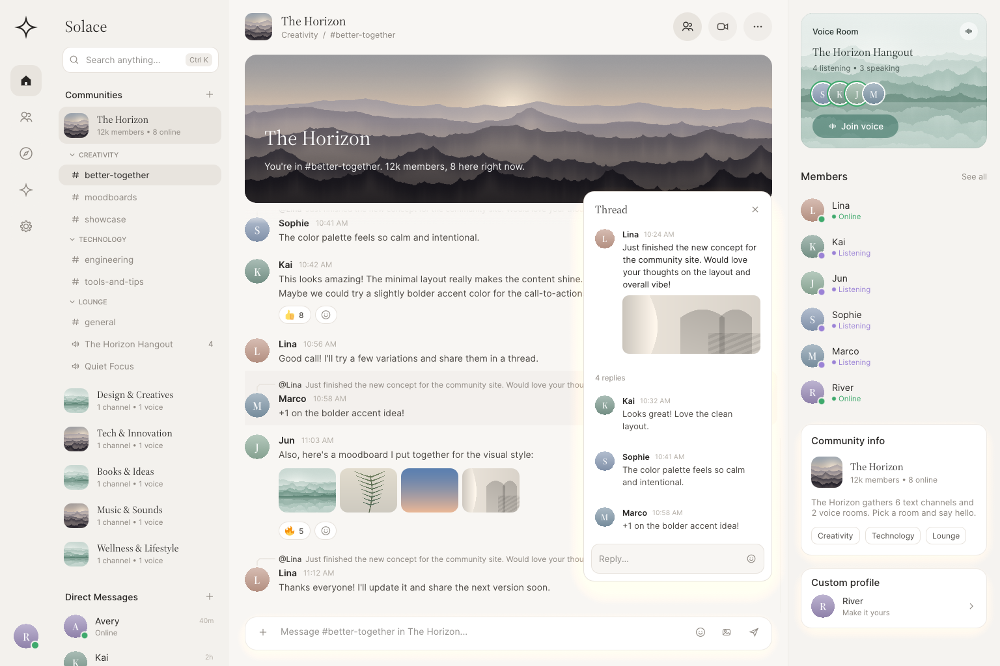

<p align="center">
  
</p>

<h1 align="center">Solace</h1>

<p align="center">A calmer place for your communities: a native, GPU-rendered Discord client.</p>



Solace is a desktop client for Discord written in Rust. Its interface is fully custom:
every surface, icon, avatar and illustration is painted by Solace itself and rendered on the
GPU through [wgpu](https://wgpu.rs) (via egui's renderer). There is no web view in the main
window and no stock widget look.

## Highlights

- **Editorial design** — warm paper and night palettes, Source Serif 4 titles with Inter
  text, soft cards, and procedurally rendered misty-mountain artwork for community banners
  and voice rooms.
- **Communities and conversations** — community list with nested channels, direct messages
  with presence, a pinned community banner, grouped timeline with replies, reactions, image
  mood boards, files and voice messages, and a floating thread panel.
- **Voice rooms** — join DM calls and server voice rooms (Opus, DAVE end-to-end encryption)
  with mute, deafen, device selection and push-to-talk.
- **Context column** — who's in the voice room, members with presence, community info and
  your profile at a glance.
- **Finding your way** — a Ctrl+K quick switcher, message search (Ctrl+F, with `from:`,
  `has:` and `pinned:` filters), pinned messages (Ctrl+P), and jumping to the message a
  reply points at.
- **People** — profile cards from any name or avatar, friend requests in Activity, and
  right-click menus to pin, copy links, mute or close conversations and leave communities.
- **Local-first** — no Solace server. Messages, drafts and images live in bounded local
  caches; your login sits in the OS credential store.

## Getting started

Solace targets **Windows** (WebView2 sign-in, Credential Manager, toast notifications).

**Install:** every CI build of the Windows workflow publishes a `solace-windows-installer`
artifact containing `solace-<version>-setup.exe`, a per-user installer (no admin rights) with
a Start Menu entry and an uninstaller in Installed Apps. Pushing a `v*` tag also attaches it
to a GitHub release.

**Build from source:**

```powershell
cargo run --locked --release -p solace
```

Requirements: the Rust MSVC toolchain, Visual Studio C++ build tools, CMake, and the
WebView2 Runtime. See [platform support](docs/platform-support.md) and
[Windows packaging](packaging/windows/README.md).

### Try the interface without an account

```sh
# Windows: the full app with a synthetic showcase
cargo run -p solace --features demo -- --demo
# ...or straight into a staged group call
cargo run -p solace --features demo -- --demo --demo-call

# Any OS with a GPU (or software Vulkan/GL): the interface preview
cargo run -p solace-ui --example preview
cargo run -p solace-ui --example preview -- --dark
cargo run -p solace-ui --example preview -- --call
```

## Repository layout

| Path | Purpose |
|---|---|
| `apps/desktop` | The `solace` binary: wires the interface to the session, cache, credentials and media engine |
| `crates/solace-ui` | The custom-painted interface and design system |
| `crates/client-core` | Single-threaded client state, navigation and command lifecycle |
| `crates/discord-api`, `crates/discord-gateway`, `crates/discord-protocol` | Discord REST, Gateway and wire types |
| `crates/discord-voice` | Voice transport, DAVE encryption, Opus and audio devices |
| `crates/local-store`, `crates/session-cache` | SQLite cache and the active timeline window |
| `crates/platform` | Windows integrations (credentials, login window, notifications, dialogs) |
| `crates/model` | Shared data model |

More in [architecture](docs/architecture.md), [design](docs/design.md),
[authentication](docs/authentication.md) and the [threat model](docs/threat-model.md).

## A note on Discord

Solace is an unofficial client and is not affiliated with Discord. Using third-party clients
may violate Discord's Terms of Service; use it with your own account and at your own risk.

## License

MIT OR Apache-2.0. Bundled fonts, emoji and sounds keep their own licenses; see
[assets](assets/README.md).
